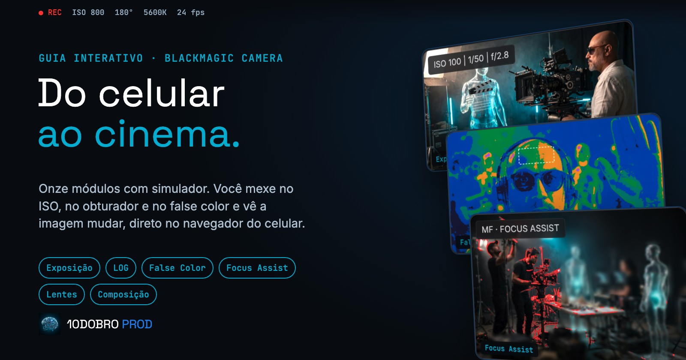
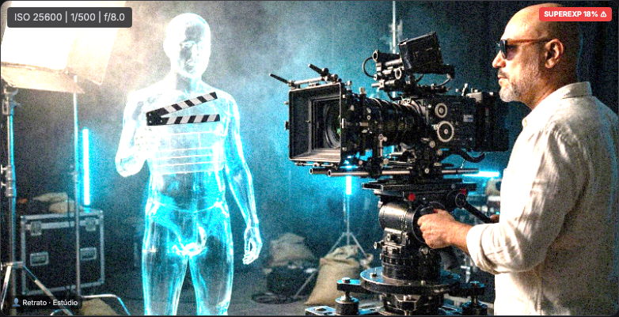
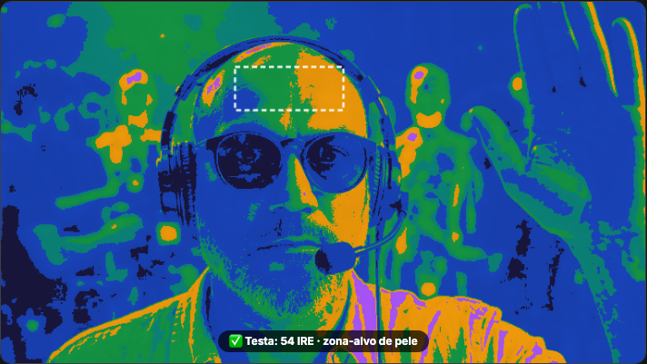
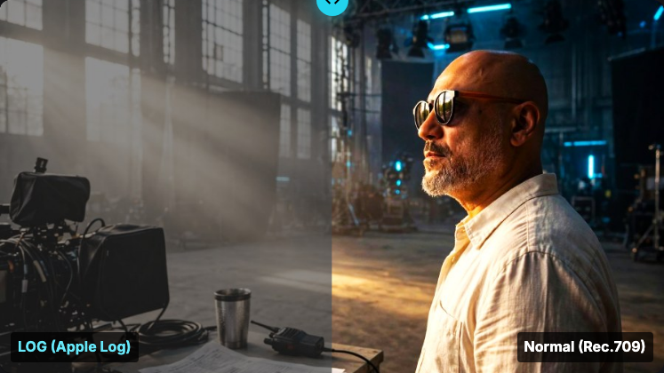
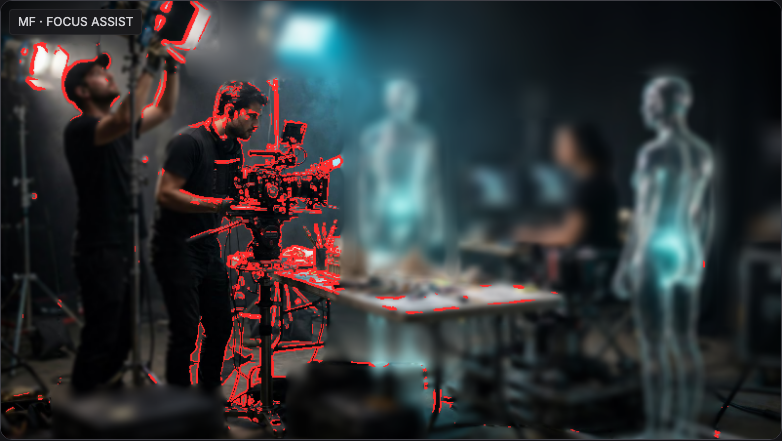
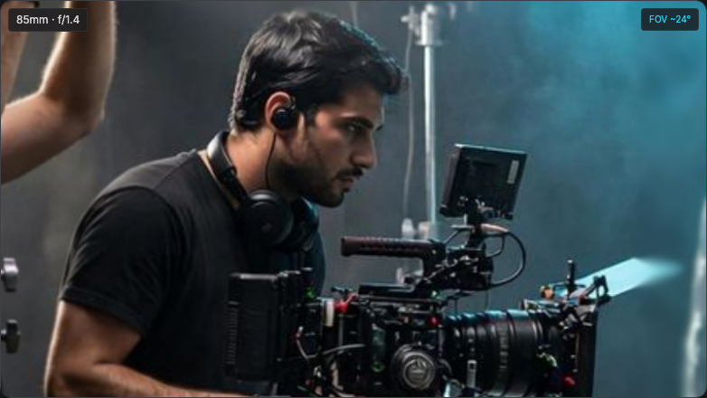
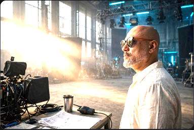

# Guia Interativo Blackmagic Camera

**Aprenda o app Blackmagic Camera mexendo nos controles, não lendo sobre eles.**

---

## O que é

Um guia interativo para quem abriu o Blackmagic Camera no celular, viu ISO, obturador, LOG e false color e voltou para a câmera normal.

Cada módulo tem um simulador. Você sobe o ISO e vê o ruído aparecer. Fecha o obturador e o movimento congela. Liga o false color e a pele ganha cor de exposição. O erro acontece no simulador, não na gravação.

## Os simuladores

| | |
|---|---|
|  |  |
| **Exposição.** ISO, obturador e abertura mexendo na mesma foto, com a regra dos 180 graus. | **False Color.** A escala do app sobre uma cena real, para ler a pele e o que estourou. |
|  |  |
| **LOG.** Arraste e compare a imagem normal com o Apple Log na mesma cena. | **Foco.** O Focus Assist marca o que está nítido; quando usar AF e quando ir para o manual. |
|  |  |
| **Lentes.** Distância focal e profundidade de campo, de 24 a 85 mm. | **Histograma.** A leitura de exposição que o app oferece no lugar do waveform. |

## Os 11 módulos

1. Boas-vindas
2. Interface do app, com a tela replicada para tocar em cada controle
3. Triângulo da exposição
4. Óptica e lentes
5. Composição
6. Luz e cor
7. Perfis LOG
8. False color
9. Foco e zoom
10. Frame rate, motion blur e codecs
11. Assistente que sugere ISO, obturador e balanço de branco para a cena descrita

A apostila animada é opcional: são 12 capítulos com diagramas e o PDF.

## Feito com cuidado nos fatos

Antes do lançamento, o Guia foi revisado contra a ficha técnica oficial do app, e 12 erros foram corrigidos. Ele também diz onde o app para. No celular, o app não grava BRAW, não tem waveform e não tem filtro ND. No iPhone 15 Pro ou mais novo, o perfil de cinema é Apple Log em ProRes.

## Como foi construído

- Simuladores em HTML, CSS e JavaScript puro, com Canvas 2D processando fotos reais pixel a pixel (exposição, false color, zebra, profundidade de campo).
- O conteúdo pago não fica no site público. Um serviço próprio (Python, FastAPI) confere cada compra, gera um código de acesso único e entrega os módulos só com um token assinado.
- Nada é instalado: o aluno abre um link no celular e entra com o código.

## Próximo passo

Um fotômetro dentro do Guia, que mede a luz da sua cena pela câmera do celular. Está em protótipo.

---

Feito pela **[10Dobro Prod](https://10dobroprod.com.br)**, produtora audiovisual e de tecnologia de São Luís, MA.

Material independente. O Guia não é afiliado à Blackmagic Design.

O código-fonte do produto é privado. Este repositório é a vitrine.

